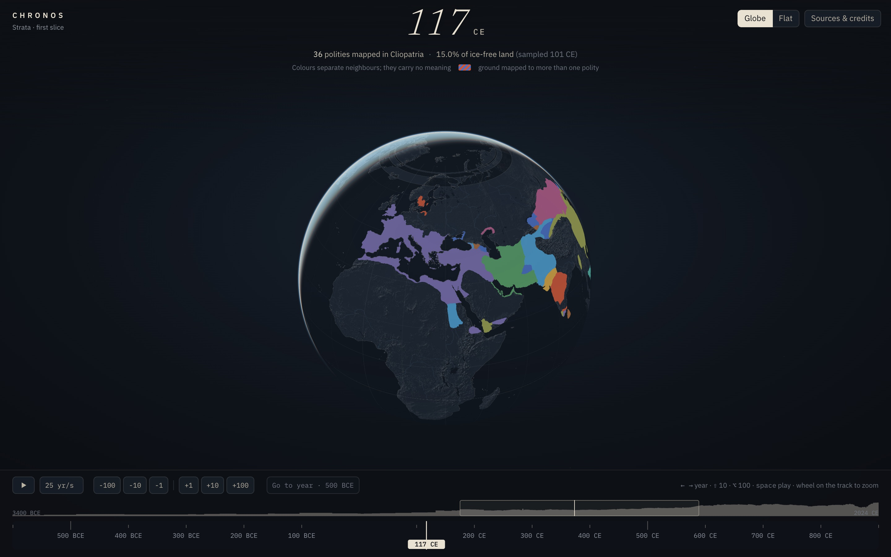

# CHRONOS

An interactive atlas of human history: a globe you travel through in time. Real, sourced polity territories rise and fall from 3400 BCE to today. Click anywhere on Earth to see every power that held that ground.

**[Open the live atlas →](https://chronos-atlas-phi.vercel.app/)**



1,637 polities and 12,064 dated territories from Cliopatria, verified against the build's checksum before drawing and rendered at 60 fps (p95 frame time 16.7 ms on an Apple M2, [report 004](docs/spikes/004-first-usable-slice.md)).

> **Status: milestone 1.3, the first usable slice.** Open the app and you get:
> - the Strata globe on a Nocturne stage;
> - a BCE/CE timeline from 3400 BCE to 2024 CE;
> - polity selection with a card showing source, licence, evidence and QA flags;
> - overlapping territories drawn as stripes of every claimant;
> - a browser-side core sample of who is mapped at any point.
>
> Every 1.2 guarantee is re-measured on the real UI ([report 004](docs/spikes/004-first-usable-slice.md)). PostGIS and the API come in 1.4.

## Quick start

```bash
make setup      # locked Python (uv) and web (pnpm) dependencies
make fetch      # pinned inputs into data/raw, sha256-verified (about 47 MB download)
make data       # all QA rules + the licence-gated public bundle (data/build/current)
make test       # pipeline + web tests, including the real-data reproduction of validation 0001
make bench      # engine benchmark in local Google Chrome; results in docs/spikes/results/
pnpm --dir apps/web dev     # the app at http://localhost:5174 (needs `make data` first)
```

**What the app needs from a host (D-031).**
- Serve each file's precompressed copy (`.br`, else `.gz`) with `Content-Encoding` when the client accepts it.
- Mark content-hashed files (`name.<12 hex>.ext`, `relief-<hash>/`) as `immutable`.
- Revalidate `bundle.json`, `trace.json` and `attributions.json`.

The dev and preview servers already do this (`apps/web/vite.config.ts`).

**The live demo** is a static site on Vercel. `infra/vercel/stage.sh` copies the web build and the public bundle into one folder, shipping the geometry as its brotli copy (46 MB raw, 3 MB compressed); `infra/vercel/vercel.json` labels it `Content-Encoding: br` and sets the caching rules above. Then `vercel deploy --prod` from that folder.

**Checking another browser.** Open `http://localhost:5174/compat.html` in it while the dev server runs. The page runs automatic checks and the benchmark protocol, takes your observations, and saves a record to `docs/compat/` ([how](docs/compat/README.md)).

The Wikidata snapshot is created once with `snapshot-wikidata` and pinned (see [pipeline/README.md](pipeline/README.md)).

## Documents


| Document | What it covers |
|---|---|
| [docs/architecture.md](docs/architecture.md) | System design, rendering engine choice, time model, pipeline, testing |
| [docs/data-model.md](docs/data-model.md) | Claim-based data model, fuzzy dates, Cliopatria mapping and findings |
| [db/schema.sql](db/schema.sql) | Draft PostgreSQL/PostGIS schema (30 tables) |
| [docs/data-sources.md](docs/data-sources.md) | Evaluated historical datasets, licenses, coverage gaps, ingestion design |
| [docs/design-direction.md](docs/design-direction.md) | Three visual directions, the recommendation (Strata), design tokens |
| [docs/roadmap.md](docs/roadmap.md) | Phases 1–5, the vertical slice, risks, decisions |
| [docs/decisions.md](docs/decisions.md) | Architecture decision log |
| [docs/validation/0001-cliopatria-117ce.md](docs/validation/0001-cliopatria-117ce.md) | Technical validation of the 117 CE data: areas, overlaps, coverage, cross-references, gaps |
| [research/phase0/](research/phase0/README.md) | The scripts that produced every Phase 0 figure, plus verified cross-reference corrections |
| [infra/postgis/](infra/postgis/README.md) | Prepared (not installed) digest-pinned PostGIS container |
| [pipeline/](pipeline/README.md) | The data pipeline: registry, QA rules QA-001 to QA-014, outputs |
| [docs/spikes/001-engine.md](docs/spikes/001-engine.md) | Engine benchmark: method, results on the M2, go/no-go |
| [docs/spikes/002-memory-and-rendering.md](docs/spikes/002-memory-and-rendering.md) | Memory profiling and optimisation, accuracy regression, culling finding (milestone 1.2) |
| [docs/spikes/003-data-delivery.md](docs/spikes/003-data-delivery.md) | Measured delivery options: compression, time chunks, vector tiles; recommendation |
| [docs/product-readiness.md](docs/product-readiness.md) | Can the foundation carry each planned CHRONOS experience? |
| [docs/plans/m1.3-first-usable-slice.md](docs/plans/m1.3-first-usable-slice.md) | Milestone 1.3 plan and acceptance criteria |
| [docs/spikes/004-first-usable-slice.md](docs/spikes/004-first-usable-slice.md) | Milestone 1.3 report: delivery, overlaps, seams, core sample, guarantees on the UI build |
| [docs/compat/](docs/compat/README.md) | Recorded browser compatibility checks |

## Stack

**In use:**
- React 19, TypeScript, Vite, Tailwind CSS v4
- MapLibre GL JS + deck.gl (globe and time layers)
- Python pipeline: Shapely, pyproj, earcut, brotli, Pillow

**Planned:** FastAPI, PostgreSQL + PostGIS (1.4); PMTiles for high-zoom regional layers (D-024).

## Data

The political spine is **Cliopatria** (Seshat Global History Databank, CC BY 4.0). The physical basemap is **Natural Earth** (public domain): land, lakes, rivers and shaded relief.

Every source CHRONOS uses is listed with its licence in [docs/data-sources.md](docs/data-sources.md). The app's Sources & credits page is generated from the licence registry.
