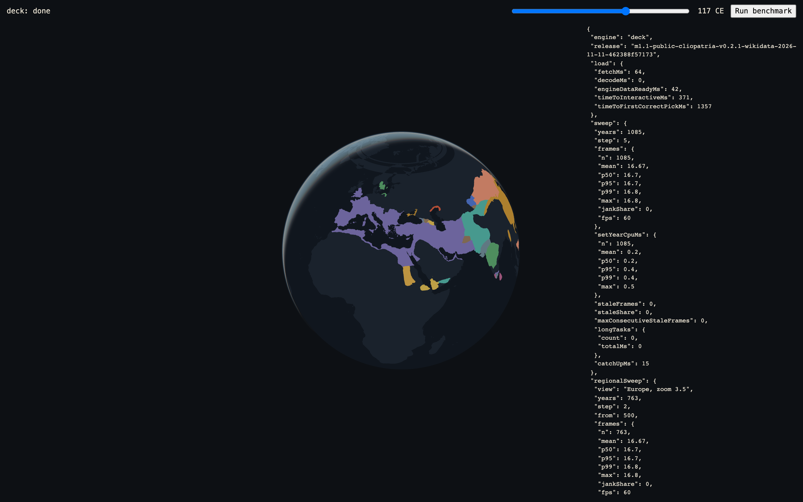

# Spike 001: rendering engine benchmark (go/no-go for D-001)

> Milestone 1.1, 2026-11-11, branch `m1.1/foundations-spike`.
> Raw results: [`results/`](results/). Reproduce with `make data && make bench`.

## Question

Can **MapLibre GL JS + deck.gl** draw every Cliopatria territory on a globe and scrub 5,424 years smoothly on this Apple M2 MacBook (8 GB), without showing anything inaccurate? And should time filtering run in deck.gl on the GPU, or in MapLibre's native layer?

## What was measured

Both engines draw the **same** data: the pipeline bundle `m1.1-public-cliopatria-v0.2.1-wikidata-2026-11-11-462388f57173`. That is 12,064 territory rows at full resolution, split on a 5° grid into 229,020 parts with 3,442,636 vertices (D-017). Both use the same MapLibre globe, basemap, camera and protocol.

| Engine | How the year filter works |
|---|---|
| **deck** | deck.gl `SolidPolygonLayer` interleaved into MapLibre (`@deck.gl/maplibre`), with `DataFilterExtension` on `[start, end]`. A year change is a GPU uniform update. |
| **maplibre** | MapLibre native `fill` layer on a GeoJSON source, with `filter` using a `global-state` expression. A year change re-evaluates the filter in MapLibre's workers. |

Protocol (`apps/web/src/bench/protocol.ts`), identical for both engines, 3 repetitions each:

1. **Load:** fetch, decode, data ready, time to interactive.
2. **Sweep:** 3400 BCE → 2024 CE in 5-year steps, one step per frame (1,085 frames), globe view.
3. **Regional sweep:** Europe at zoom 3.5, 500 → 2024 CE in 2-year steps (762 frames). This is the densest part of the data.
4. **Jumps:** a random year every frame (300 frames).
5. **Latency:** set a random year, then wait until a frame showing it is fully rendered (40 samples).
6. **Pick accuracy:** 343 ground-truth points from the pipeline (`testpoints.json`): 263 inside a polity and 80 on unmapped land. Each point is at least 60 km from every boundary alive in its year. At each point the harness sets the year, centres the camera at zoom 3 and asks the engine what it drew at that pixel. The answer must equal the expected polity (or nothing).

The two numbers that matter most for accuracy:
- **Stale frames:** frames drawn while the engine had not yet applied the last requested year. They are smooth, and wrong.
- **Pick accuracy:** whether what's on screen matches the data.

**Environment:** Apple M2 (8 GB), macOS 27.0.1, Google Chrome 157, headless, driven by playwright-core. WebGL renderer: **"ANGLE Metal Renderer: Apple M2"** (the real GPU, not a software fallback). Viewport 1440×900 at device pixel ratio 2.

## Findings before the numbers

These came out of building the spike. Each changed the design:

1. **`@deck.gl/mapbox` 9.4.0 crashes with MapLibre 6** in interleaved mode (`getViewport` reads a property MapLibre 6 no longer passes). The supported integration is `@deck.gl/maplibre` (`MapLibreOverlay`). → D-019.
2. **Default depth testing makes deck.gl polygons z-fight with MapLibre's globe surface.** Territories render speckled with holes. That is a silent accuracy failure that a frame-rate benchmark alone would never catch. Drawing polygons with `depthCompare: "always"` fixes it. A far-side check (Pacific view, 1914, when the hidden hemisphere is almost fully covered) shows deck's globe projection already clips the back hemisphere, so nothing leaks through. → D-019.
3. **MapLibre 6 is ESM-only** and starts its worker from a sibling file by relative URL; Vite's dependency pre-bundling breaks that. The fix is to exclude it from `optimizeDeps`.
4. **`filterSoftRange` would show polities outside their valid years** (faded). Transitions must be time-based instead. → D-020.

## Results (3 repetitions per engine; medians, with the worst run where noted)

Raw data: [`results/2026-11-11-m2-chrome157-headless.json`](results/2026-11-11-m2-chrome157-headless.json) (full protocol) and [`results/2026-11-11-m2-chrome157-headless-load.json`](results/2026-11-11-m2-chrome157-headless-load.json) (load only).

| Metric | deck.gl (GPU filter) | MapLibre native (global-state filter) | Target |
|---|---|---|---|
| Time to first correct pick (honest time to interactive) | **1.25 s** (1.21–1.36) | 7.27 s (6.82–7.45) | ≤ 3 s |
| Engine "ready" signal | 0.34 s (precedes drawable geometry by about 0.9 s) | 7.26 s | — |
| Sweep, 1,085 frames: frame time p50 / p95 / p99 | 16.7 / 16.7 / 16.8 ms | 16.7 / 16.8 / 16.8 ms | p50 ≤ 16.7, p95 ≤ 33 |
| Europe sweep, 762 frames: p50 / p95 / worst frame | 16.7 / 16.7 / 16.8 ms | 16.7 / 16.7 / 33.3 ms | |
| Random jumps, 300 frames: p95 / frames over 33 ms (worst run) | 16.7 ms / 0% | 16.7 ms / 0.3% | |
| **Stale frames while scrubbing** (all three sweeps) | **0%** | **100%** (every frame behind the requested year) | 0% |
| Year change → frame fully current: p50 / p95 / worst | 33.4 / 35.0 / 35.8 ms | 33.7 / 65.9 / 82.4 ms | |
| Main-thread cost of a year change, p95 | 0.2–0.4 ms | 0.1 ms (work moves to workers) | |
| Long tasks during scrubs | 0 | 0 in this run (see the note below) | |
| **Pick accuracy** (343 ground-truth points: 263 inside, 80 unmapped) | **343/343 in all 3 runs** | 343/343 in all 3 runs, after waiting for idle | 100% |
| JS heap after the protocol | about 820 MB (818–926 across all runs) | 334–923 MB across runs | |

**How to read the two accuracy rows together.** Once settled, both engines draw exactly what the data says: every ground-truth point matched in every run. The difference is what happens *while time moves*. MapLibre re-evaluates the filter in its workers, taking 2–4 frames per change. During a continuous scrub it never catches up, so **every frame showed an older year than the one requested**. A timeline reading "1066" would sit over a map from a few frames earlier. deck.gl applies the year as a GPU uniform in the next frame.

**Controls and caveats**
- *Is MapLibre's 100% an artifact of the check?* The stale check uses `map.loaded() && map.areTilesLoaded()`. As a control, deck.gl was scored with the same check (`?current=maploaded`, [`results/2026-11-11-control-deck-maploaded-quick.json`](results/2026-11-11-control-deck-maploaded-quick.json)) and came out 0% stale. The basemap and atmosphere don't trip it; MapLibre's filter re-evaluation does.
- *deck.gl's 0% is by construction, verified indirectly.* The uniform update is drawn in the next frame by design. The evidence is the control above and 343/343 picks; no pixel-level readback was done for every scrub frame.
- *The "ready" signal is misleading for deck.gl.* It fires about 0.9 s before geometry can be picked, so the honest load metric is time to first correct pick, and the application needs a "loading territories" state gated on real readiness. The full protocol now waits for the first correct pick before it starts. The results above come from that corrected rerun.
- *An earlier full run* (before that wait was added) gave the same deck.gl numbers. For MapLibre it recorded worse outliers in the Europe sweep: a worst frame of 467 ms, 4 long tasks totalling 640 ms, and a worst latency of 618 ms. Its raw file was replaced by the rerun; the numbers come from the run log.
- *Frame times are capped at 60 Hz* by headless Chrome's frame clock, so headroom beyond 60 fps isn't measured. deck.gl's 0.2 ms year-change cost and zero long tasks suggest substantial headroom.
- *Not yet measured:*
  - **Safari and Firefox.** Automating Safari requires enabling "Allow Remote Automation", a system setting I won't change. Manual check: run `make bench-quick`, or open `/bench.html?engine=deck&run=1` and read the JSON on the page.
  - **A headed window on the real display.**
  - **A mid-range Windows laptop.**
  - **Production tiling (PMTiles)**, which arrives in 1.2.

## Screenshots (117 CE, identical data)

| deck.gl | MapLibre native |
|---|---|
|  |  |

## Recommendation: GO for D-001, with deck.gl as the time engine

**Go:** MapLibre GL JS for the globe, basemap and labels; deck.gl (`@deck.gl/maplibre`, interleaved) for every time-dynamic layer, filtered on the GPU. All 1.1 acceptance targets are met:
- 60 fps scrubbing with no stale frames;
- 1.25 s to first correct pick;
- 100% pick accuracy;
- byte-identical data builds;
- QA reproduces validation 0001;
- the licence gate is proven by tests.

**No-go for MapLibre-native time filtering of territories.** The frames are smooth, but the content lags the year during every scrub. That is precisely the accuracy-for-smoothness trade the project rules out. Load is also 6× slower.

**Conditions carried into 1.2**

1. **Memory.** deck.gl holds about 820 MB of JS heap. Heap readings vary with garbage collection, but deck.gl was consistently high. The likely cause, not yet profiled, is that polygon normalisation copies every part's coordinates into JS arrays. The 1.2 target is under 400 MB, via binary attributes and pre-normalised rings (`_normalize: false`). Accuracy must be re-verified with the same 343-point test after the change.
2. **Readiness gating.** The UI must wait for real geometry readiness, not the engine's ready signal.
3. **Cross-browser check.** Run the harness in Safari and Firefox (manual), and on one non-Apple machine, before 1.3.
4. **Depth.** Revisit `depthCompare: "always"` when terrain or 3D extrusions arrive (D-019).

