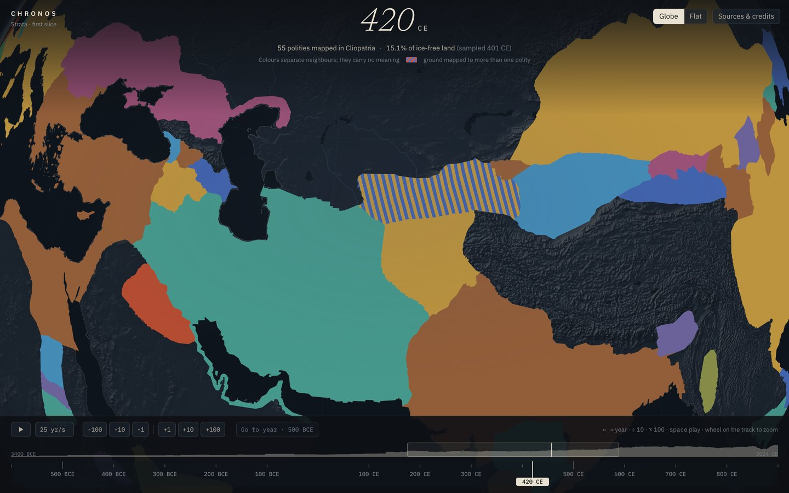
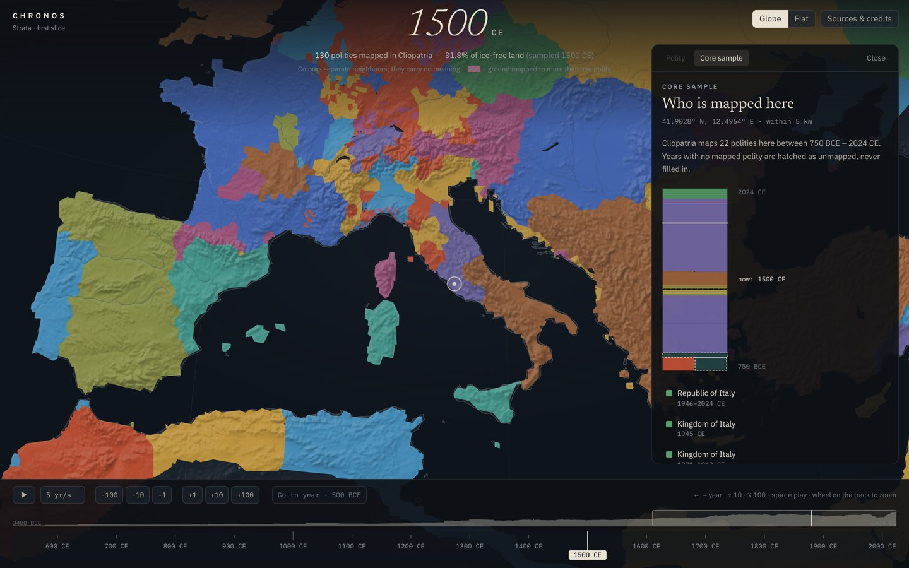
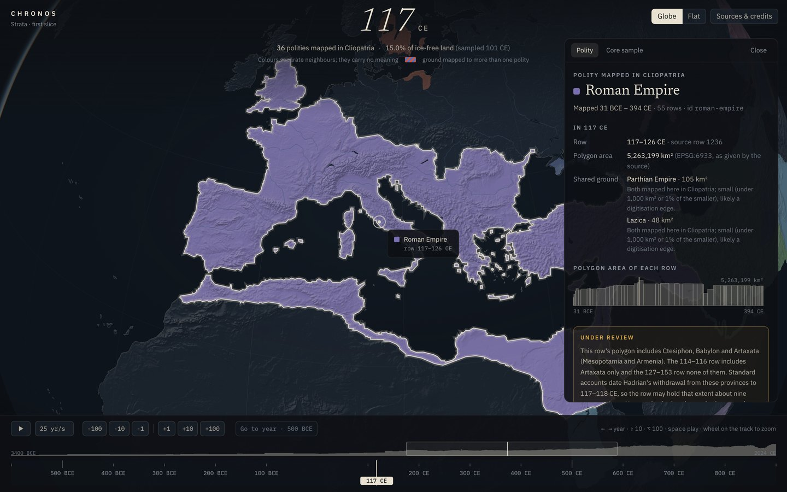

# Report 004: the first usable slice (milestone 1.3)

> 2026-11-11, branch `m1.3/first-usable-slice`.
>
> Same machine and method as spikes [001](001-engine.md) and [002](002-memory-and-rendering.md): Apple M2 (8 GB), Chrome 157 headless on the real GPU, 1440×900 at device pixel ratio 2. Raw results are in [`results/`](results/) and screenshots in [`img/m13/`](img/m13/). The plan and acceptance criteria are in [plans/m1.3](../plans/m1.3-first-usable-slice.md).

## Outcome against the plan

| Acceptance criterion (plan) | Result |
|---|---|
| Decode is lossless | **Met.** Checked in every build, and cross-language in the web tests (pipeline-encoded bytes decoded in TypeScript) |
| `make reproducible` byte-identical, compressed files included | **Met.** 371 files, every brotli/gzip copy and relief tile included. Re-verified after the seam fix; identical to the build every measurement here used. |
| Geometry ≤ 3 MiB with brotli | **Met.** 2.84 MiB |
| First correct pick at 117 CE ≤ 1.5 s | **Met.** 743 / 733 / 615 ms on the production build |
| Error with retry on a failed fetch | **Met.** The loading card shows the error and a Try again button |
| 60 fps with the full stage; 0% stale frames | **Met.** p50 16.7 ms in every phase; 0% stale in sweep, Europe and explore, 3 runs |
| Steps across 1 BCE / 1 CE, ticks, formatting, URL round-trip tested | **Met.** 8 web tests |
| Select and hover cause no attribute uploads | **Met after a fix (§6).** Hover originally uploaded ≈ 1.9 MB of picking colours per event; it now uploads 0 B from deck.gl. A year change uploads 0 B from deck.gl (≤ 7 KB from MapLibre). Selecting the Roman Empire uploads only its new outline layer (≈ 42 KB). |
| Pick accuracy 343/343 with the extension | **Met.** 343/343 in all 3 runs |
| Heap < 400 MB | **Met.** 281 / 355 / 301 MB without GC; endurance worst 359.7 MB |
| 420 CE Kidarites × White Huns striped | **Met.** Screenshot below |
| Overlap regions match QA-004 at checkpoints | **Met.** Checked in every build (§2) |
| Rome equals QA-010 exactly; test points agree | **Met.** 22 strata, gaps and overlaps identical; 343/343 test points agree |
| Grid seams: root cause and fix or documentation | **Met, fixed.** Two causes, neither the grid (§3) |
| No research-only source in the build | **Met.** QA-012 enforced; every source in `bundle.json` is public |
| Safari manual run recorded | **Partly run, not saved (§7).** Your run passed WebGL2, shaders, module workers, sha256, CSS and immutable caching. The delivery check failed: Safari received the 17.24 MiB gzip copy, not brotli. The benchmark and checklist were not run. |

## 1. Delivery: bundle format 3 (WP1; D-024, D-025, D-031)

| File (first view) | Raw | On the wire (brotli) |
|---|---|---|
| `geometry.<hash>.bin`: territories, overlaps, varint triangles, edge flags, labels | 46.0 MB | **2.84 MiB** |
| `bundle.json`: catalogue, palette, sources, coverage, file manifest | 0.32 MiB | 0.04 MiB |
| `basemap-*` (land, coastline, lakes, rivers) | 3.1 MiB | 0.70 MiB |
| relief tiles for one globe view (of 341 tiles, 11.8 MiB in all) | | ≈ 0.3 MiB |
| application JavaScript (MapLibre, deck.gl, React, app) | | 0.47 MiB gzip |
| `catalog.<hash>.json`, loaded when the first card opens | 0.30 MiB | 0.02 MiB |

- **Triangles.** Per-part delta, zigzag and LEB128 varints: 7.9 MiB raw instead of 31.5 MiB, and the same 0.48 MiB with brotli as spike 003's best option. The build decodes them again and fails unless they equal the source triangles.
- **Server.** The dev and preview servers negotiate `Accept-Encoding` (Chrome received `br`). Hashed files are served `immutable`; `bundle.json` is revalidated.
- **Loading.**
  - A worker fetches the geometry with real progress, checks its sha256 against `bundle.json` (79 ms), decodes the varints (125 ms) and builds the per-vertex attributes (26 ms).
  - The worker transfers the typed arrays to the main thread without copying them.
  - Fetch over localhost takes about 100 ms.
- **Readiness.** The loading card ends only at the **first correct pick**: a territory valid in the current year, visible on screen, picked back at its label point.

**Time to the first correct pick at 117 CE**, from navigation start:

| Where | Result |
|---|---|
| Dev server, smoke runs (`bench/smoke.mjs`) | 673, 738, 790, 841 ms. One run right after a server restart took 1,816 ms because Vite compiles modules on demand. |
| Production build (`vite preview`, the benchmark runs in §6) | 743 / 733 / 615 ms (3 runs) |
| Target | ≤ 1.5 s |

The worker's own timings on the dev server:

| Step | Time |
|---|---|
| `bundle.json` | 13 ms |
| Geometry fetch | 100 ms |
| sha256 check | 79 ms |
| Varint decode | 125 ms |
| Per-vertex attributes | 26 ms |
| **Total** | **344 ms** |

Uploading to the GPU until the first frame takes about 360 ms more.

## 2. Overlapping territories (WP5, D-026)

- **Regions.** 6,861 overlap regions across all years: 6,632 shared by two rows, 223 by three, 6 by four, none by five or more.
  - Kinds: linked 389, sliver 5,510, unlinked 733, multiple 229.
  - Size: 99 k vertices (2.8% of the territory mesh).
- **Check against QA-004.** The build checks that the regions reproduce QA-004's totals at every checkpoint year:

  | Year | Regions | QA-004 |
  |---|---|---|
  | 500 BCE | 110,581 km² | 110,581 km² |
  | 117 CE | 207 km² | 207 km² |
  | 420 CE | 489,037 km² | 489,037 km² |
  | 1000 CE | 1,183 km² | 1,182 km² |
  | 1500 CE | 18,198 km² | 18,205 km² |
  | 1914 CE | 3,265 km² | 3,263 km² |

  The small differences come from intersecting in lon/lat versus in equal-area coordinates; all are within the build's 0.1% tolerance.
- **Display.** Regions draw above the fills as world-anchored stripes cycling through every claimant's colour, so the display no longer depends on draw order. Picking returns every claimant, and repeated clicks cycle through them.
- **Card wording.** The card says, for example: "Parthian Empire · 105 km². Both mapped here in Cliopatria; small (under 1,000 km² or 1% of the smaller), likely a digitisation edge."

## 3. The "grid seams" of spike 002 (WP8, D-028)

`bench/seams.mjs` located every line-like disagreement between deck.gl and MapLibre in the spike 002 view (1500 CE, Europe, zoom 4). It unprojected each one to lon/lat and rendered both engines at zoom 8 on the spot. Two causes, neither of them the grid:

| Cause | Evidence | Fix |
|---|---|---|
| **16,487 triangles (0.6%) faced inward on the globe.** They are counter-clockwise in lon/lat, but long slivers (typically along a cut on a parallel at high latitude, where the parallel is a small circle) face inward as flat triangles through their projected vertices. Back-face culling (D-022) dropped them. | With `cull=none` the Scandinavian seam disappears. Python on the bundle: every seam pixel lies inside its part's triangles in lon/lat and Mercator. | Orient each triangle by its outward normal in deck.gl's globe space. **0** inward-facing triangles remain. |
| **Long edges drawn as 3D chords.** GeoJSON edges are straight in lon/lat; deck.gl draws straight chords on the globe. The worst real border drifted 4.95 km. | Black Sea, Ionian and Algerian clusters: deck.gl fills or misses a thin band along long coast edges. | Densify real borders longer than 1° (+3% vertices). Worst drift is now 0.22 km. Grid cuts are left alone because both sides share the same chord. |

| Check | Before | After |
|---|---|---|
| Scandinavian seam at zoom 8: pixels where deck.gl and MapLibre differ | 20,151 | **545** (edge anti-aliasing) |
| Line-like clusters in the 1500 CE Europe view | 5 | 1: mid-Atlantic, 15 px at zoom 4, **0 px at zoom 8** (MapLibre's own low-zoom tiling) |

| Before (deck.gl, zoom 8) | MapLibre | After (deck.gl) |
|---|---|---|
|  |  |  |

**What this means for 1.2.** The 1.2 renderer also dropped these slivers. The 343-point pick test could not see it: its points are at least 60 km from any boundary, and the gaps lie along cuts. Render agreement at globe zoom stayed under 0.1%. The fix ships in format 3. Raw results: [`results/2026-11-11-seams-before.json`](results/2026-11-11-seams-before.json), [`-after.json`](results/2026-11-11-seams-after.json).

## 4. Core sample in the browser (WP7)

`src/lib/coreSample.ts` ports the pipeline's `PointIndex`:
- exact hit = the row's polygon covers the point;
- near hit = within 5 km, by distance to edges in a local WGS84 tangent plane;
- strata merged by the same rule;
- gaps and overlaps computed the same way.

On the real bundle (vitest):
- **Rome equals the pipeline's QA-010 result exactly.** 22 strata with the same names, years, exact or near flags and source rows. The same gaps (476–499 CE and 1944 CE) and the same four overlaps. The Roman Kingdom's near-hit distance agrees within 1% (3.89 km).
- **All 343 ground-truth test points agree.** The exact strata valid in a point's year are exactly its expected polities, and unmapped points get none.

**Speed.** The index (part bounding boxes in a 2° grid) is built once, on the first sample: 115 ms. A query then takes a median of 0.27 ms and at most 3.0 ms (7 places × 5 runs). It runs on the main thread; a worker is not needed.

The column divides each period equally among the polities mapped then, so it splits only where they overlap. Gaps are hatched as *unmapped* and never filled. Near hits are dashed with their distance.

## 5. The application (WP2–WP4, WP6)

| Part | What was built |
|---|---|
| **Strata stage** (Nocturne) | Night-ink ocean; unclaimed land a step lighter; hillshade relief above the fills (lighter at regional zoom); modern lakes and rivers; faint coastline and graticule; atmospheric rim; a soft scrim behind the header. Globe ↔ flat. Tokens from design-direction.md as Tailwind v4 `@theme`. Newsreader, Plex Sans and Plex Mono self-hosted. |
| **Timeline** | Overview strip: record density (polities mapped per year) for 3400 BCE–2024 CE, with a draggable window. Detail track: zoom with the wheel around the cursor, pan with shift or a horizontal wheel. Ticks fall on round historical years and never on a year 0 (tested). Play, pause and speed; steps of ±1/10/100; "go to year" accepts "500 BCE"; keyboard ←/→, ⇧, ⌥, space, Home/End; the view lives in the URL hash, and back/forward apply. |
| **Transitions** (D-020, D-029) | Steps and jumps cross-dissolve between the two attested states over 240 ms of wall-clock time. Scrubbing and playback cut, and reduced motion always cuts. Picking always uses the current year. |
| **Selection** (D-029) | Click selects; repeated clicks on shared ground cycle through the claimants. The selected polity stays bright with a bone outline along real borders only (edge flags), and the rest recede. Hover lightens. A shader extension on the globe hides the outline's far side. |
| **Polity card** | Name, mapped span, row count, id. In the current year: the row (source row locator), its polygon area (EPSG:6933, as given), and shared ground with each other claimant, with area and kind. A sparkline of polygon area per row. "Under review" notes. Wikidata as given, or as corrected with the source's own (wrong) label kept visible. QA findings with plain-language rule titles. Source, licence, evidence (*interpreted*), confidence (*not stated by the source*), release, and "How is this calculated?" (the trace). |
| **Header** | The year in Newsreader italic, "N polities mapped in Cliopatria", and coverage from the nearest QA-011 sample, always naming the sample's year. A legend: colours carry no meaning; stripes mean ground mapped to more than one polity. |
| **Credits** | Generated from the registry: every source with licence, access tier and evidence; palette note; software and fonts; release id; trace link. |
| **Integrity wording** | "mapped", never "ruled" or "controlled". The core sample is titled *Who is mapped here*: the brief's "who ruled here?" is answered in the design-direction's terms. |

## 6. Guarantees from 1.2, re-measured on the application

| Guarantee | 1.2 (harness) | **1.3 app, production build, runs 1 / 2 / 3** | Target |
|---|---|---|---|
| Pick accuracy, 343 points | 343/343 ×3 | **343/343 / 343/343 / 343/343** | 343/343 |
| Frame time p50 / p95, sweep | 16.7 / ≤16.8 ms | 16.7/16.7 / 16.7/16.7 / 16.7/16.7 ms | 60 fps |
| Stale frames (sweep, Europe, explore) | 0% | **0%,0%,0% / 0%,0%,0% / 0%,0%,0%** | 0% |
| JS heap after protocol, no GC | 248–255 MB | **281 / 355 / 301 MB** (endurance worst 359.7 MB) | < 400 MB |
| After forced GC: on-heap + array buffers | 29 + 217 MB | 25.7+230.1 / 25.7+230.1 / 25.6+230.1 MB | |
| First correct pick, 117 CE | 0.52–0.63 s | **743 / 733 / 615 ms** | ≤ 1.5 s |

The app adds the overlap layer, outline, React UI and basemap layers on top of the 1.2 path. The heap rose about 50–100 MB without GC (garbage between collections), while retained memory after GC is about the same as 1.2 (≈ 256 MB vs 246 MB). Raw: [`results/2026-11-11-m2-chrome157-headless-m13-app.json`](results/2026-11-11-m2-chrome157-headless-m13-app.json).

### Render agreement, GPU uploads and hover picking (verification after the benchmark)

**Render agreement of the application** (`bench/agreement.mjs`). The app and the 1.2 binary path both render in mask mode: territories white on black, no basemap, atmosphere or stripes.

| View | Pixels covered | Pixels that differ |
|---|---|---|
| 117 CE globe | 19,191 | **0** |
| 1914 Pacific (far side) | 7,228 | **0** |
| 1500 Europe | 631,799 | **0** |
| 500 BCE Near East | 187,264 | **0** |
| 1765 Mughal area, zoom 7 | 992,840 | **0** |
| 1265 Lithuania, zoom 5 | 1,092,923 | **0** |
| 420 CE Central Asia | 621,975 | **0** |

StrataExtension (exact years) draws exactly what DataFilterExtension drew. Raw: [`results/2026-11-11-agreement-m2-chrome157-headless.json`](results/2026-11-11-agreement-m2-chrome157-headless.json).

**GPU buffer uploads per interaction** (`bench/smoke.mjs`, uploads step). It counts every `bufferData`/`bufferSubData` byte, waits for the map to be idle, and starts with a no-interaction control. On the dev server, uploads are attributed by library from the call stack.

| Interaction | deck.gl bytes (dev) | All bytes (production build) |
|---|---|---|
| Control: no interaction | 0 | 0 |
| Year change 117 → 118 → 117 | 0 (MapLibre 4.9 KB) | 4.9 KB |
| Hover over a territory, before the fix | **1,925,752** | — |
| Hover over a territory, after the fix | **0** (MapLibre 2.5 KB) | 2.5 KB |
| Select the Roman Empire (adds its outline) | 8.3 KB (+ 34 KB outline buffers) | 47.5 KB |
| Deselect | 0 (MapLibre 4.9 KB) | 4.9 KB |

For scale, the initial upload is 137.7 MB. A geometry re-upload would be at least one per-vertex attribute: 3.55 M vertices × 4 B = 14 MB.

**The hover finding.** Hover used deck.gl's 4-deep `pickMultipleObjects` to list every claimant. To exclude objects already found, depth picking re-uploads ranges of the picking-colour buffer: about 1.9 MB on every hover.

Hover and click now use one picking pass for the polity drawn on top. The other claimants come from the explicit overlap regions (D-026), point-tested on the CPU over 13,953 parts. The multi-pass `pick()` stays as the benchmark's reference.

The two methods return the same set of polities at **3,060 of 3,060** grid points in three views:

| View | Points | Agree | On shared ground |
|---|---|---|---|
| 420 CE Central Asia | 1,020 | 1,020 | 39 |
| 500 BCE China | 1,020 | 1,020 | 14 |
| 1500 CE Europe | 1,020 | 1,020 | 6 |

**Production smoke** (`bench/smoke.mjs --preview`): every step passed with no console errors or warnings:
- load: first correct pick 658 ms (earlier production runs: 685 and 718 ms);
- uploads and claimants (above);
- selecting the Roman Empire by clicking Rome at 117 CE;
- the 420 CE overlap;
- the Rome core sample (24 rows listed: 22 strata and 2 gaps);
- flat projection;
- the dissolve.

Record: [`img/m13/smoke.json`](img/m13/smoke.json).

## 7. Browsers

| Browser | Status |
|---|---|
| Chrome 157 headless (Metal GPU) | Measured: the full protocol on the production build, 3 runs (§6) |
| **Safari** | **Partly checked; delivery fails over plain HTTP.** Your run of `http://localhost:5174/compat.html`, as you reported it (not saved): • Passed: WebGL2, the StrataExtension shader features, module workers, sha256, CSS, immutable caching. • **Failed:** precompressed geometry. 43.9 MiB decoded, 17.24 MiB transferred. • Not run: the benchmark and checklist. |
| | **Cause, measured on the server side** (`bench/delivery-headers.mjs`, 40/40 checks on the dev and preview servers): • 17.24 MiB is byte-for-byte the gzip copy. The server sends `br` (2.84 MiB) whenever a request offers `br`, and gzip only when it does not. • So Safari's request on `http://localhost` did not offer `br`. Chrome and Firefox advertise `br` only on secure connections ([Brotli header is only sent on HTTPS connections](https://groups.google.com/g/brotli/c/fN6M9A8aRnM); Chrome treats `localhost` as secure). Safari doing the same over plain HTTP is the likely explanation, but no source states it. • The compat page now records the `Accept-Encoding` the server actually received (`/__echo`) and the `Content-Encoding` Safari actually got. The next run proves or disproves this. |
| | **Not weakened.** The delivery check now has two parts: • *Server sent the best encoding offered* (D-031): should pass. • *Brotli geometry on the wire, ≤ 3 MiB* (D-024): stays failing whenever gzip arrives. In Chrome both pass (offer `gzip, deflate, br, zstd`; 2.84 MiB `br`). |
| Firefox | Not installed; the same page works there. |

## 8. Known limitations and follow-ups

- **Safari** has not had the benchmark or the checklist run, and over plain HTTP it receives 17.24 MiB of gzip instead of 2.84 MiB of brotli (§7). Production hosting over HTTPS is expected to give Safari brotli. That expectation is unverified until Safari is tested over HTTPS, which needs a certificate it trusts (a keychain trust change, your decision).
- **Label spines** and on-map names wait for 1.6. Names appear on hover, in the card and in the core sample.
- **Era bands** (PeriodO) need that source; it is not yet registered.
- **Fuzzy dates and per-territory confidence** do not exist in Cliopatria. The card says so instead of inventing them.
- **Coverage statement.** QA-011 samples every 100 years, so the header names the sample year, for example "15.0% … (sampled 101 CE)". The 15.7% in validation 0001 is 117 CE on 1:10m land. A per-year series would need a union per year, which the pipeline does not compute yet.
- **Edge chords on grid cuts.** These still drift up to 3.0 km from the lon/lat line. Both sides share the chord, so no gap results, but a polity border that coincides with a cut is densified only when flagged real.
- **Production JavaScript** is a 1.7 MB chunk (0.47 MB gzip), mostly MapLibre and deck.gl. Splitting it is a 1.6 task.
- **Build time** rose from about 75 s to about 2 min 45 s: overlap regions, relief tiles and brotli at quality 11. `make reproducible` takes about 6 minutes.
- **Hosting** must serve the precompressed copies with `Content-Encoding` and immutable caching (D-031). A host that cannot falls back to raw files: 46 MB of geometry.
